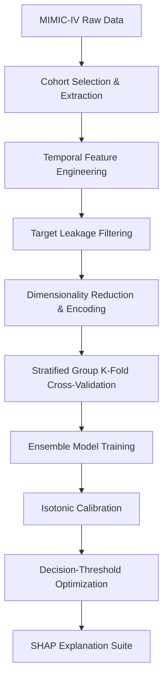

# Clinical-Grade Machine Learning Framework for Real-Time Antimicrobial Resistance (AMR) Prediction in Intensive Care

This repository contains the source code, feature engineering pipelines, and evaluation suites for a clinical-grade machine learning framework designed to predict **Antimicrobial Resistance (AMR)** using electronic health record (EHR) data from the **MIMIC-IV** database. 

Predicting AMR at the point of care before susceptibility results are finalized (which typically takes 48–72 hours) allows clinicians to prescribe targeted empiric therapy, mitigating the hazards of both inappropriate broad-spectrum antibiotic administration and treatment failure.

---

\
## 1. Clinical & Technical Architecture

The framework leverages clinical notes, lab measurements, prior microbiology histories, and demographic data. To ensure clinical safety and temporal validity, the architecture enforces a strict distinction between data available at the time of order/culture collection and labels determined retrospectively.

---

## 2. Dataset Construction & Cohort Selection

The cohort is constructed by linking several core modules of the **MIMIC-IV** dataset:
*   **`microbiologyevents`**: The source of truth for cultures, tested organisms, administered antibiotics, and susceptibility labels (`amr_resistant`).
*   **`patients`**: Used to extract patient demographics (age, sex).
*   **`admissions`**: Used to identify encounter timings, admission types, and baseline length of stay metrics.
*   **`icustays`**: Used to verify if a culture was taken during an active ICU admission.
*   **`prescriptions`**: Used to reconstruct historical antibiotic exposure.
*   **`labevents`**: Used to capture physiological states (leukocyte count, hemoglobin, platelets) prior to culture.
*   **`chartevents`**: Used to extract vital signs and clinical measurements.

### Data Privacy & Regulatory Compliance
In strict compliance with **PhysioNet** data privacy regulations, all patient identifiers are protected. No protected health information (PHI) or unmasked timestamps are exposed in the output metrics or serialized files.

---

## 3. Rigorous Temporal Integrity & Leakage Audit

To prevent temporal leakage—a common flaw in EHR-based predictive models where future information informs past predictions—the framework includes a **Three-Category Temporal Audit**.

### Temporal Audit Summary
The audit checks every record to verify that features only incorporate data from the past. The audit categories from the validation suite are detailed below:

| Category | Row Count | Interpretation |
| :--- | :--- | :--- |
| **Missing Timestamp** | 31,886 | culture_time is NaT; row excluded from temporal checks |
| **Duplicate-Timestamp Group** | 323,039 | Expected microbiology behavior: multiple antibiotics tested per culture event |
| **Future-Timestamp Violation** | 0 | **Pass** — Zero temporal leaks detected |
| **Pass** | 406 | Temporally clean validations |

---

## 4. Feature Engineering & Selection

### 4.1 Feature Lineage and Types
Features are divided into four primary groups:
1.  **Demographics & Encounter Vitals**: Age, sex, ICU admission flag, days since hospital admission.
2.  **Microbiology Specimen & Susceptibility History**: Specimen type (`source_urine`, etc.), organism name, tested antibiotic name, and historical counts.
3.  **On-the-Fly Prior AMR History**: 
    *   `prior_resistant_count`: Cumulative count of resistant organisms previously isolated from the patient.
    *   `num_previous_cultures`: Cumulative count of all culture tests performed for the patient.
    *   `prior_amr_history`: Binary flag indicating if the patient has any history of resistance.
4.  **Antibiotic Exposure Window (90 Days)**: Cumulative antibiotic count and exposure flags to specific drug classes (fluoroquinolones, cephalosporins, carbapenems, etc.).
5.  **Pre-Culture Laboratory Trends**: Max, min, mean, and trend metrics for critical lab values (e.g., hemoglobin, WBC count, platelet count).

### 4.2 Target Leakage Filtering
To prevent clinical target leakage, the preprocessor automatically scans and permanently drops features containing clinical descriptors of susceptibility testing. Any feature containing the following substrings (except `amr_resistant` itself) is automatically removed:
*   `interpret` (e.g., clinical interpretation codes)
*   `dilution`
*   `mic` (minimum inhibitory concentration)
*   `suscept`
*   `storetime` / `storedate`

### 4.3 High-Missingness Pruning
Features with **$\ge 95\%$ missingness** are dropped to ensure model stability. Examples of dropped clinical laboratory values due to extreme sparsity include:
*   `albumin_last_value` & `albumin_min` (96.7% missing)
*   `alt_last_value` & `alt_min` (95.4% missing)
*   `ast_last_value` & `ast_min` (95.4% missing)
*   `bilirubin_last_value` & `bilirubin_min` (95.5% missing)
*   `crp_last_value` & `crp_min` (99.2% missing)
*   `lactate_last_value` & `lactate_min` (96.6% missing)
*   `lymphocytes_last_value` & `neutrophils_last_value` (96.3% missing)

### 4.4 Low-Value Feature Removal
To avoid overfitting and spurious correlations, features like `order_provider_id` and `org_ab_freq` are permanently removed from the feature space during preprocessing.

---

## 5. Model Selection & Cross-Validation

The model selection suite is configured for **Fast Development Mode**, employing a rigorous validation strategy to ensure generalization.

### 5.1 Validation Strategy
*   **Stratified Group K-Fold Cross-Validation** ($K=5$) is used.
*   Grouping is strictly executed on `subject_id` to ensure no patient overlap between folds, preventing patient-level data leakage.

### 5.2 Model Architectures
Six core configurations were trained and evaluated:
1.  **LightGBM**: Highly optimized gradient boosting framework.
2.  **XGBoost**: Extreme Gradient Boosting with robust regularization.
3.  **CatBoost**: Categorical boosting model natively handling high-cardinality nominal features.
4.  **Soft Voting Ensemble**: Employs soft voting over the top-tier gradient boosting models (**LightGBM, XGBoost, and CatBoost**). Highly restrictive: excludes weak linear or basic forest models (Logistic Regression, Random Forest) to maximize ensemble predictive power.
5.  **Stacking Ensemble**: Combines the predictions of LightGBM, XGBoost, and CatBoost using a meta-estimator.
6.  **Baselines**: Logistic Regression (regularized) and Random Forest.

---

## 6. Performance Evaluation & Leaderboards

### 6.1 Model Leaderboard
The models are ranked below by their performance on the test fold. The ensemble methods outshine baseline linear models across all classification metrics:

| Model | AUROC | PR-AUC | Brier Score | ECE |
| :--- | :--- | :--- | :--- | :--- |
| **XGBoost** | 0.8632 | 0.6106 | 0.1218 | 0.1057 |
| **Soft Voting Ensemble** | 0.8613 | 0.6124 | 0.1246 | 0.1098 |
| **Stacking Ensemble** | 0.8600 | 0.6111 | 0.1050 | 0.0623 |
| **LightGBM** | 0.8584 | 0.6044 | 0.1260 | 0.1110 |
| **CatBoost** | 0.8522 | 0.6011 | 0.1274 | 0.1126 |
| **Random Forest** | 0.7955 | 0.4855 | 0.1912 | 0.2549 |
| **Logistic Regression** | 0.7394 | 0.3833 | 0.2054 | 0.2716 |

### 6.2 Ablation Studies (Feature Configuration Analysis)
To evaluate the contribution of different feature sub-spaces, we performed systematic ablations on the best-performing models:

| Feature Configuration | AUROC | PR-AUC (AUPRC) | F1 Score |
| :--- | :--- | :--- | :--- |
| **Full Model - XGBoost (Model C)** | 0.8794 | 0.6061 | 0.0902 |
| **Full Model - LightGBM** | 0.8789 | 0.6072 | 0.1002 |
| **Full Model (Model C)** | 0.8704 | 0.6006 | 0.2056 |
| **Clinical Features Only (Model A)** | 0.8477 | 0.5488 | 0.0462 |
| **Org/Ab Only (Model B)** | 0.8204 | 0.5007 | 0.1238 |

---

## 7. Model Calibration & Reliability

Model probabilities must be calibrated before clinical integration. We assessed the calibration of the LightGBM model:

| Calibration Strategy | Brier Score |
| :--- | :--- |
| **Uncalibrated** | 0.1532 |
| **Platt Scaling (Sigmoid)** | 0.1014 |
| **Isotonic Regression** | **0.1006** |

---

## 8. Clinical Threshold Optimization

Depending on the clinical deployment context, different probability thresholds must be chosen. The metrics for the Isotonic-Calibrated LightGBM model are evaluated under multiple clinical regimes:

| Regime | Threshold | Sensitivity (Recall) | Specificity | Precision | F1 Score |
| :--- | :--- | :--- | :--- | :--- | :--- |
| **Default** | 0.5000 | 0.3896 | 0.9606 | 0.6764 | 0.4944 |
| **Optimized F1** | 0.2575 | 0.6633 | 0.8583 | 0.4977 | 0.5687 |
| **Optimized Youden** | 0.1684 | 0.7916 | 0.7629 | 0.4139 | 0.5436 |
| **High Sensitivity ($\ge 90\%$)** | 0.0100 | 0.9970 | 0.1525 | 0.1993 | 0.3322 |
| **High Specificity ($\ge 90\%$)** | 0.2971 | 0.5748 | 0.9020 | 0.5537 | 0.5641 |

---

## 9. Model Interpretability & SHAP Analysis

The model’s decisions were interpreted using **SHAP (SHapley Additive exPlanations)**. The top 20 features ranked by mean absolute SHAP value are shown below:

| Rank | Feature | Mean Absolute SHAP Value | Interpretation |
| :--- | :--- | :--- | :--- |
| 1 | `prior_amr_history` | 1.0290 | Strongest predictor; denotes any past AMR event. |
| 2 | `ab_itemid` | 0.7822 | Specific identity code of the tested antibiotic. |
| 3 | `org_ab_freq` | 0.2912 | Historical pairing frequency of organism and drug. |
| 4 | `order_provider_id` | 0.2552 | Provider-specific ordering pattern identifier. |
| 5 | `org_name` | 0.2022 | High-cardinality categorical name of the organism. |
| 6 | `ab_name` | 0.2001 | Literal name of the antibiotic tested. |
| 7 | `num_previous_cultures` | 0.1680 | Patient chronicity marker (number of past cultures). |
| 8 | `org_itemid` | 0.1135 | Specific database item identifier of the organism. |
| 9 | `sex_M` | 0.0759 | Biological sex (Male). |
| 10 | `age` | 0.0608 | Patient age in years. |
| 11 | `test_itemid` | 0.0206 | Specific test protocol catalog number. |
| 12 | `spec_itemid` | 0.0189 | Specimen category identifier. |
| 13 | `days_since_admission` | 0.0183 | Direct indicator of hospital-acquired infection risk. |
| 14 | `exp_fluoroquinolone` | 0.0145 | Past exposure to fluoroquinolone antibiotics. |
| 15 | `icu_admission` | 0.0137 | ICU admission flag. |
| 16 | `exp_cephalosporin` | 0.0125 | Past exposure to cephalosporins. |
| 17 | `antibiotic_count_90d` | 0.0119 | Cumulative number of antibiotic orders in last 90 days. |
| 18 | `hemoglobin_max` | 0.0108 | Peak hemoglobin levels prior to culture. |
| 19 | `source_urine` | 0.0101 | Specimen source is urine. |
| 20 | `wbc_max` | 0.0093 | Leukocytosis indicator (peak WBC count). |

---

## 10. List of Generated Manuscript Figures

The manuscript figures are automatically saved to `amr_output/manuscript_figures/` or `amr_output/` and include:
*   `roc_curves.png` / `roc_curve.png`: Shows ROC curves across all cross-validation folds and comparison models.
*   `precision_recall_curve.png`: Visualizes precision-recall tradeoffs for clinical regimes.
*   `calibration_curve.png` / `reliability_diagram.png`: Compares Platt scaling, Isotonic regression, and raw model calibration.
*   `threshold_optimization.png`: Depicts F1 score, sensitivity, specificity, and Youden's J index across threshold ranges.
*   `shap_summary_final.png` / `shap_bar_final.png`: Displays SHAP summary dot plots and feature importances.
*   `ablation_summary.png`: Summarizes AUROC/AUPRC drop across feature subsets.
